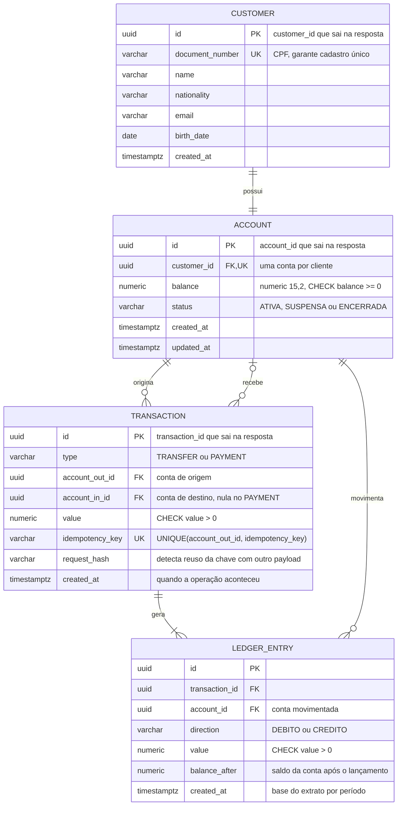
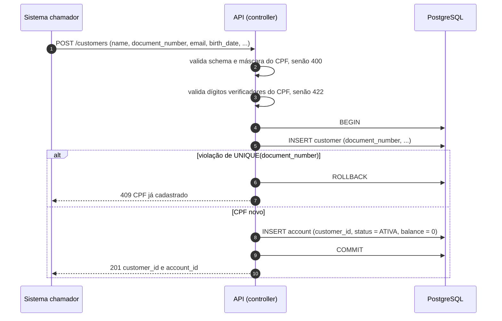
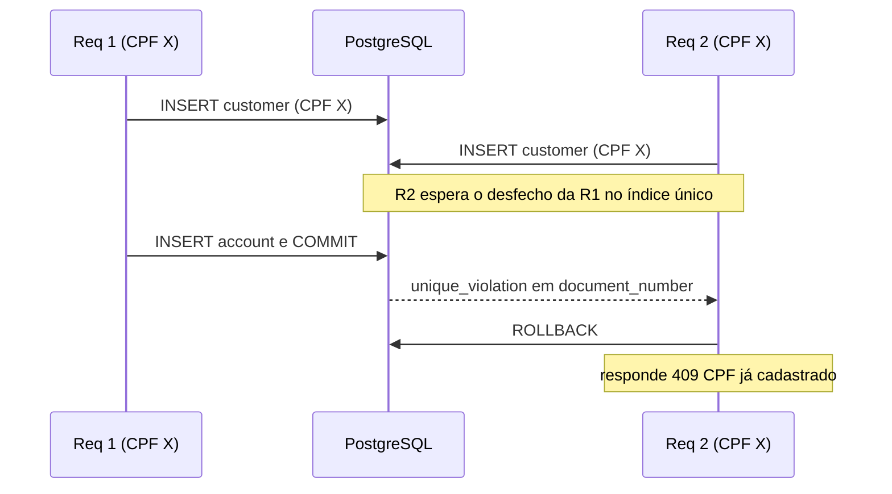
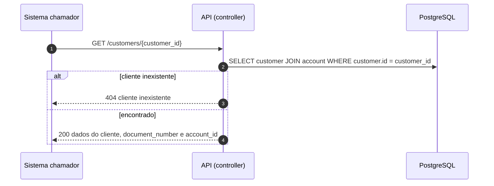
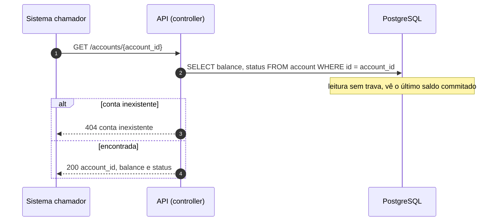
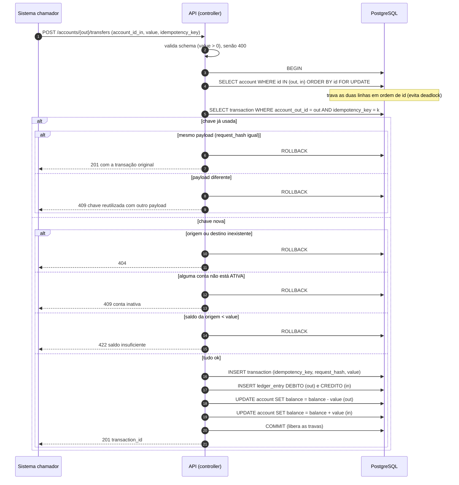
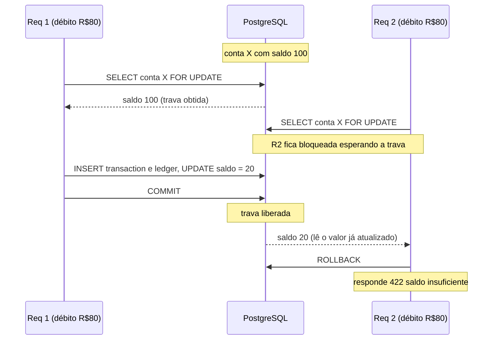
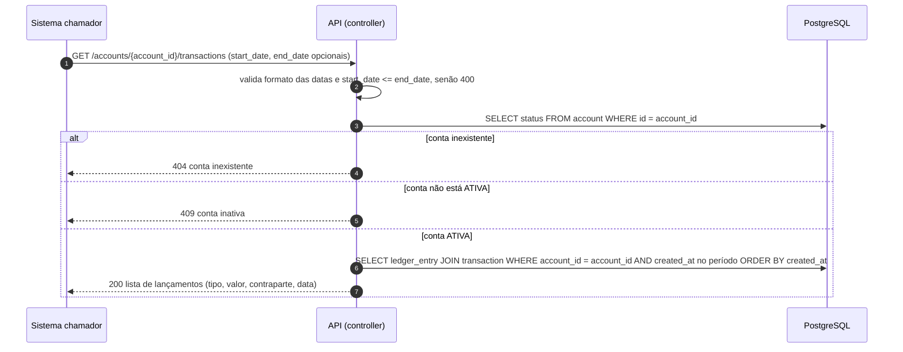

# RFC — o banco dos entregadores de aplicativos

| | |
|---|---|
| **Time** | Fernando Mendes · Victor Kazunori · Matheus Reis |
| **Data** | 29/09/2026 |
| **Versão** | 1|

## Contextualização

### Entendendo o problema

O banco deve fornecer os produtos bancários básicos, cadastro de conta, consulta de saldo, realizar e receber transferências, realizar pagamentos e consultar o extrato de transações. Quem chama o serviço são outros sistemas, identificados por um token interno.

A solução precisa sustentar as seguintes garantias:
- Cadastro único: um cliente só poderá ser cadastrado uma única vez, identificado por seus dados cadastrais, e terá uma única conta ativa associada.
- Garantia financeira: uma transação só poderá ser concluída quando houver saldo suficiente na conta de origem e a conta de destino, quando aplicável, for válida e estiver ativa. A operação deverá ser atômica, garantindo que seus lançamentos ocorram integralmente ou não ocorram.
- Ciclo de vida da conta: uma conta poderá assumir os status ATIVA, SUSPENSA ou ENCERRADA, respeitando as regras de transição definidas pelo sistema.
- Rastreabilidade financeira: toda movimentação concluída deverá possuir registro suficiente para permitir a consulta e reconstrução do histórico da operação.
- Consistência do saldo: operações concorrentes sobre uma mesma conta devem ser serializadas ou controladas de forma que o saldo nunca seja comprometido por operações além dos recursos disponíveis.
- Idempotência: uma mesma solicitação de operação financeira não poderá produzir mais de uma transação efetiva, mesmo que a requisição seja reenviada.

Fora do escopo dessa entrega: solução de investimento para incidente inesperado do tipo "caixinha", solicitação de empréstimos, contratação de seguro veicular. 

### Explicando a solução de forma macro

A solução é composta por quatro entidades principais — customer, account, transaction e ledger_entry. O cliente possui uma conta bancária, que mantém o saldo e seu ciclo de vida. Cada operação financeira é registrada como uma transação e gera um ou mais lançamentos sobre as contas envolvidas: uma transferência interna gera um débito e um crédito, enquanto um pagamento externo gera apenas o débito na conta do cliente. As operações são processadas de forma atômica, com controle de concorrência sobre o saldo, e utilizam uma chave de idempotência para impedir que uma mesma solicitação produza mais de uma operação financeira. Restrições de unicidade garantem o cadastro único, enquanto os lançamentos preservam o histórico necessário para rastrear as movimentações.

Alternativas descartadas:

- **Calcular o saldo apenas a partir dos lançamentos:** descartado porque cada consulta de saldo exigiria a agregação do histórico e aumentaria o custo das consultas; seria uma alternativa interessante em um sistema com menor frequência de consulta ou forte necessidade de reconstrução do saldo.

- **Modelar transferência como dois registros independentes:** descartado porque permitiria que débito e crédito fossem tratados separadamente; a transação única garante que os dois lados sejam confirmados ou revertidos juntos.

- **Permitir reprocessamento de uma mesma requisição:** descartado porque uma falha de comunicação poderia levar o sistema externo a reenviar a operação e movimentar o mesmo valor mais de uma vez; seria aceitável apenas para operações explicitamente tolerantes a duplicidade.

- **Controlar saldo exclusivamente na aplicação:** descartado porque múltiplas requisições concorrentes poderiam validar o mesmo saldo antes de atualizá-lo; seria uma alternativa viável apenas com outro mecanismo de serialização ou controle de concorrência.

## Implementação

### Rotas

> *Uma linha por rota, na tabela abaixo. Regras:*
>
> - *Status de erro **explícitos** — `400`, `404`, `409`, `422`, e em que situação cada um sai. Não
>   basta escrever "erro".*
> - *Diga se a rota é **idempotente** e, se for, o que a torna idempotente (qual campo, qual
>   restrição). Repetir a mesma requisição é tema da Aula 2.*
> - *Em "Entrada", só os campos que importam para a decisão — não é o schema completo.*
>
> *Não entra aqui: código.*

| Método | Caminho | O que faz | Entrada (campos que importam) | Saídas (status e quando) |
|---|---|---|---|---|
| `GET` | `/` | Diz qual serviço é este.   Aberta, sem token | - | `200`|
| `GET` | `/health_check` | Diz se o serviço está de pé.   Aberta, sem token | - | `204`|
| `POST` | `/customers` | Cadastra o cliente e sua conta.   Repetir não cria outro cliente: `UNIQUE(document_number)` | `name`, `nationality`, `document_number` (CPF `000.000.000-00`), `email`, `birth_date` ...   | `201` com `customer_id` e `account_id`; `400` `EB000001` corpo fora do formato, incluindo CPF ausente ou fora da máscara; `409` `EB001024` CPF já cadastrado; `422` `EB001023` CPF com dígitos verificadores que não batem|
| `GET` | `/customers/`   `{customer_id}` | Devolve um cliente, com `document_number` e `account_id` | `customer_id` no caminho | `200`; `404` `EB001012` cliente inexistente |
| `GET` | `/accounts/`   `{account_id}` | Consulta o saldo da conta | `account_id` no caminho | `200`; `404` `EB00XXXX` conta inexistente |
| `POST` | `/accounts/{account_id_out}/`   `transfers` | Realiza uma transferência para outra conta do banco.   Idempotente: `UNIQUE(account_out_id, idempotency_key)` | `account_id_out` no caminho, `account_id_in`,  `value` e `idempotency_key` no corpo | `201` com `transaction_id` (reenvio com a mesma chave devolve o `201` original); `400` `EB00XXXX` valor inválido; `404` `EB00XXXX` conta origem/destino inexistente; `409` `EB00XXXX` conta inativa ou chave reutilizada com outro payload; `422` `EB00XXXX` saldo insuficiente |
| `POST` | `/accounts/{account_id_out}/`   `payments` | Realiza um pagamento para fora do banco.   Idempotente: `UNIQUE(account_out_id, idempotency_key)` | `account_id_out` no caminho,  `value` e `idempotency_key` no corpo | `201` com `transaction_id` (reenvio com a mesma chave devolve o `201` original); `400` `EB00XXXX` valor inválido; `404` `EB00XXXX` conta de origem inexistente; `409` `EB00XXXX` conta inativa ou chave reutilizada com outro payload; `422` `EB00XXXX` saldo insuficiente |
| `GET` | `/accounts/{account_id}/`   `transactions` | Consulta o extrato de transações de uma conta | `account_id` no caminho,  `start_date` (opcional), `end_date` (opcional) | `200`; `400` `EB00XXXX` datas fora do formato ou `start_date` posterior a `end_date`; `404` `EB00XXXX` conta inexistente; `409` `EB00XXXX` conta está inativa |

**Idempotência**: as operações financeiras (transfers e payments) exigem o campo `idempotency_key` no corpo. Requisições repetidas com a mesma chave devem retornar o mesmo resultado da primeira execução, sem gerar uma nova transação. O uso da mesma chave com payload diferente resulta em 409 Conflict.

### Banco de Dados (Somente diagrama)

> *Só o diagrama. Entidades, chaves, relacionamentos e os campos que importam para o desafio: o que
> garante unicidade, o que guarda estado, o que registra quando aconteceu, o identificador que sai
> na resposta. **Sem prosa nesta seção** — se o principal desafio do seu desenho é o modelo de
> dados, o único texto aqui é o destaque "Principal desafio". Substitua o esqueleto abaixo pelo seu
> diagrama.*

### Fluxos

**Cadastro de cliente e conta — caminho feliz e falhas (400, 409, 422)**

**Cadastro — falha: duas requisições concorrentes com o mesmo CPF**

**Consulta de cliente — caminho feliz e falha (404)**

**Consulta de saldo — caminho feliz e falha (404)**

**Transferência — caminho feliz e falhas (404, 409, 422, reenvio idempotente)**

O pagamento (`POST /accounts/{account_id_out}/payments`) segue o mesmo fluxo, mas trava só a conta de origem e grava só o lançamento de débito, já que o destino é externo ao banco.

**Transferência — falha: duas requisições concorrentes na mesma conta**

**Extrato de transações — caminho feliz e falhas (400, 404, 409)**

> ## Principal desafio
>
> - **Qual é:** garantir que o saldo nunca fique negativo nem seja debitado duas vezes quando há requisições concorrentes sobre a mesma conta, sejam operações diferentes ou o reenvio da mesma.
> - **Por que é difícil:** a solução óbvia (ler o saldo, comparar, gravar) tem um intervalo entre a leitura e a gravação. Nesse intervalo, outra requisição lê o mesmo saldo e as duas debitam. Na transferência há uma tensão a mais: travar duas contas em ordem arbitrária leva a deadlock entre A→B e B→A.
> - **Como o desenho resolve:** as contas envolvidas são travadas com `SELECT … FOR UPDATE` em ordem crescente de `account_id`. Em seguida vem a checagem de idempotência, depois a de saldo e status, e por fim a gravação de `transaction`, `ledger_entry` e saldo, tudo na mesma transação. A trava só é liberada no `COMMIT`. Quem chega depois espera, lê o saldo já atualizado e recebe `422` se não couber. O reenvio com a mesma chave encontra a transação gravada e recebe o `201` original. O `UNIQUE(account_out_id, idempotency_key)` barra o caso residual.
