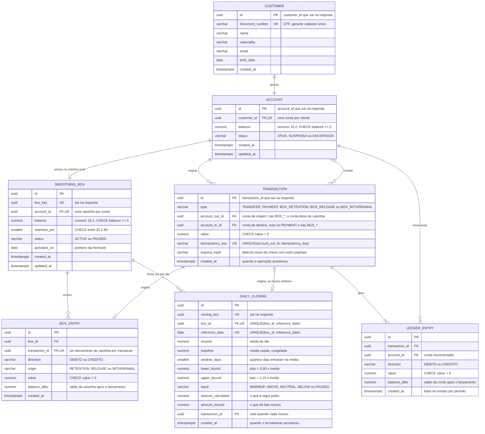
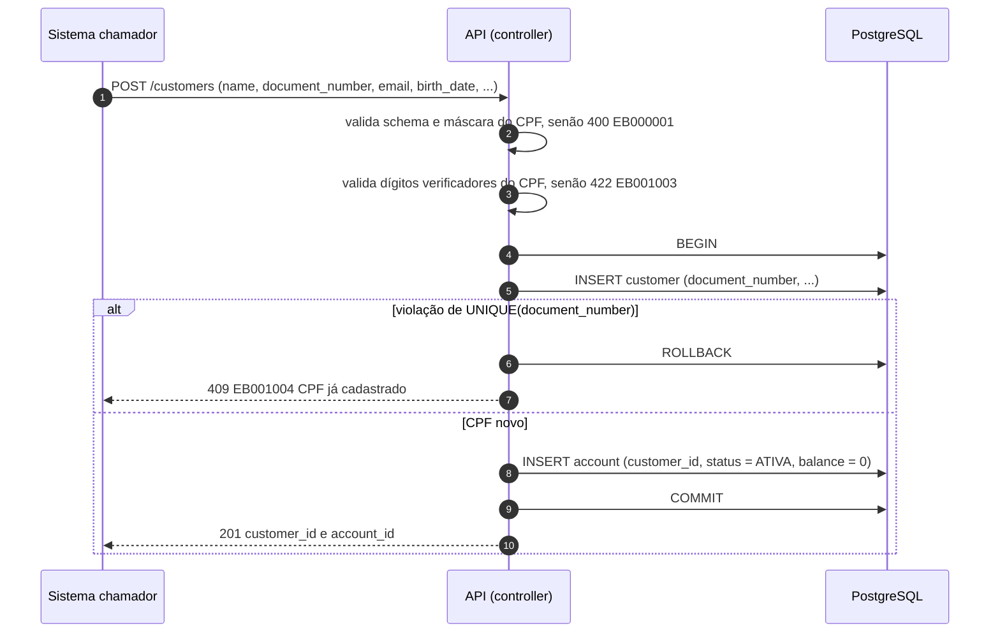
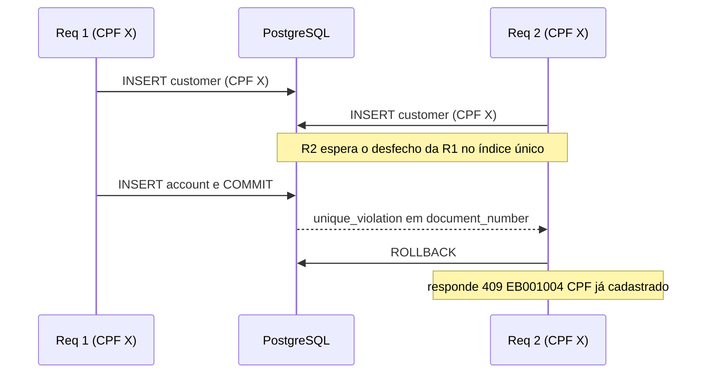
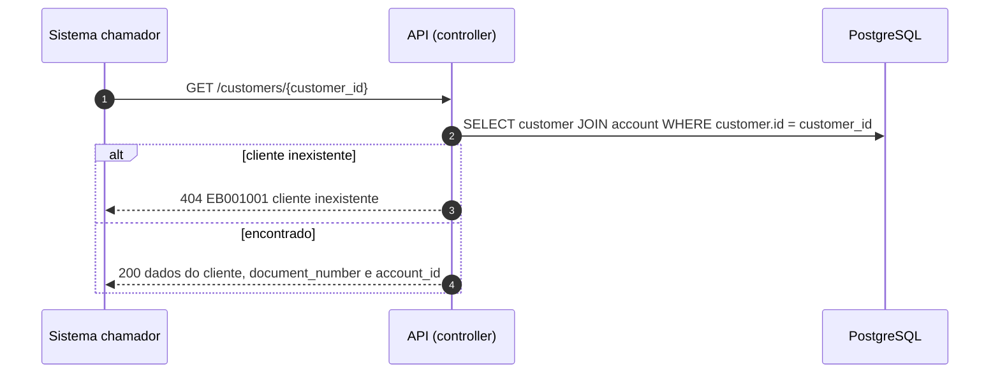
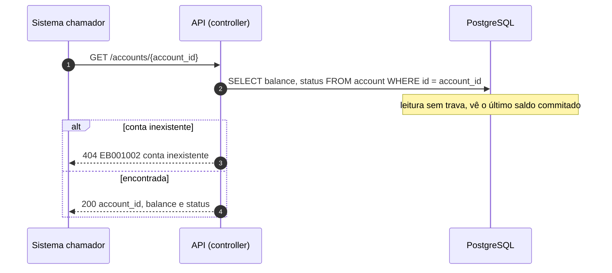
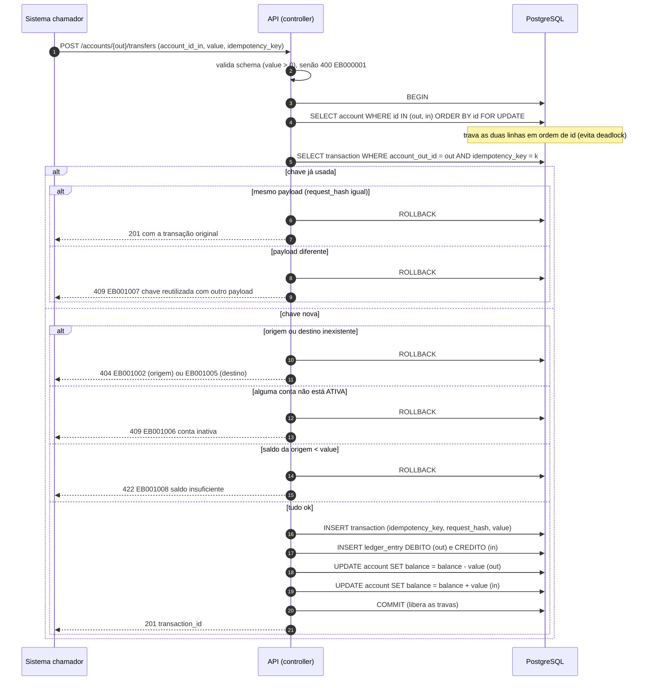
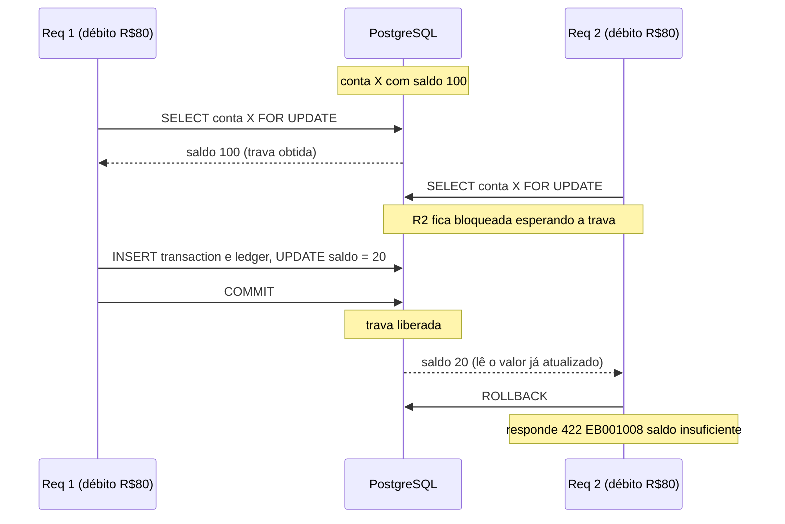
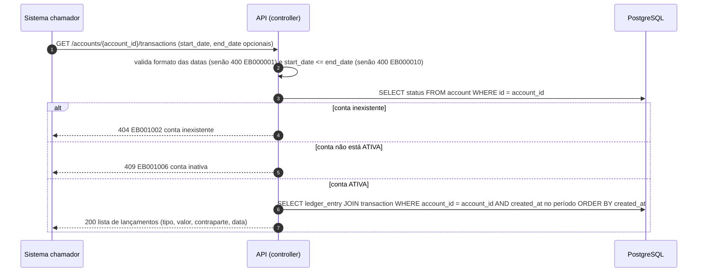
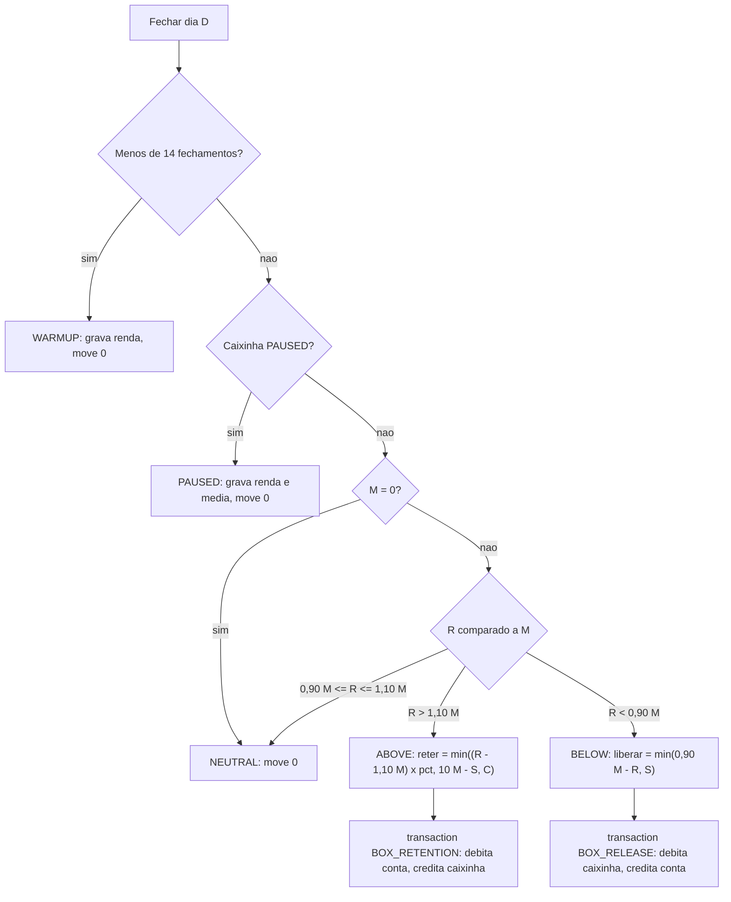
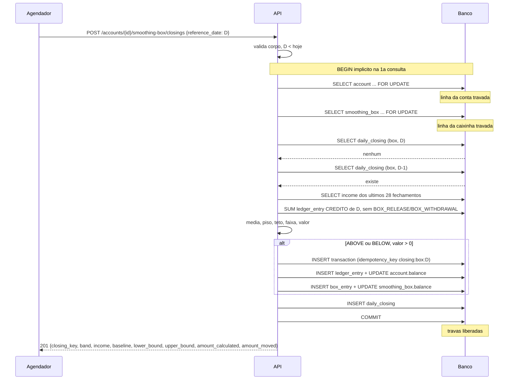

# RFC — o banco dos entregadores de aplicativos

| | |
|---|---|
| **Time** | Fernando Mendes · Victor Kazunori · Matheus Reis |
| **Data** | 05/10/2026 |
| **Versão** | 2 |

## Contextualização

### Entendendo o problema

O banco deve fornecer os produtos bancários básicos, cadastro de conta, consulta de saldo, realizar e receber transferências, realizar pagamentos e consultar o extrato de transações. Além disso, o banco implementa a solução da Caixinha do Equilíbrio. O entregador recebe por dia, e o valor de cada dia é imprevisível: um sábado de chuva vale o triplo de uma terça parada. A Caixinha de Equilíbrio dá previsibilidade a essa renda: fecha cada dia, compara a renda do dia com a média recente do próprio cliente, guarda parte do que passou da média e, nos dias abaixo dela, devolve o suficiente para chegar a um piso. Quem chama o serviço são outros sistemas, identificados por um token interno.

A solução precisa sustentar as seguintes garantias:
- **Cadastro único**: um cliente só poderá ser cadastrado uma única vez, identificado por seus dados cadastrais, e terá uma única conta ativa associada.
- **Garantia financeira**: uma transação só poderá ser concluída quando houver saldo suficiente na conta de origem e a conta de destino, quando aplicável, for válida e estiver ativa. A operação deverá ser atômica, garantindo que seus lançamentos ocorram integralmente ou não ocorram.
- **Ciclo de vida da conta**: uma conta poderá assumir os status ATIVA, SUSPENSA ou ENCERRADA, respeitando as regras de transição definidas pelo sistema.
- **Rastreabilidade financeira**: toda movimentação concluída deverá possuir registro suficiente para permitir a consulta e reconstrução do histórico da operação.
- **Consistência do saldo**: operações concorrentes sobre uma mesma conta devem ser serializadas ou controladas de forma que o saldo nunca seja comprometido por operações além dos recursos disponíveis.
- **Conservação do dinheiro:** o dinheiro só anda entre a conta e a caixinha do mesmo cliente; toda retenção, liberação e resgate é uma `transaction` do time, com lançamento na conta e na caixinha na mesma transação de banco. Se falhar, o saldo some de um lado sem aparecer no outro.
- **Um fechamento por dia:** cada dia de cada caixinha é fechado uma vez só; repetir o fechamento não retém nem libera de novo. Se falhar, o agendador que reenvia o pedido retém duas vezes.
- **Regra reproduzível:** a média, o piso e o teto usados em cada fechamento ficam gravados; o mesmo dia, refeito no papel, dá o mesmo valor. Se falhar, não há como explicar ao cliente por que o banco reteve R$ 50.
- **Nunca negativo:** a retenção não deixa a conta negativa e a liberação não passa do saldo da caixinha, mesmo com uma transferência do cliente chegando no mesmo instante.
- **Liquidez:** o cliente resgata o saldo da caixinha quando quiser; o dinheiro é dele.
- **Idempotência**: uma mesma solicitação de operação financeira não poderá produzir mais de uma transação efetiva, mesmo que a requisição seja reenviada.

A receita do banco vem do *float*: o saldo somado das caixinhas fica parado em média vários dias e é aplicado pela tesouraria em ativos de liquidez diária.

Fora do escopo desta entrega: a aplicação financeira do saldo (tesouraria), rendimento repassado ao cliente, o agendador em si, encerramento da caixinha, seguro de moto/vida/trabalho.

### Explicando a solução de forma macro

A solução é composta por sete entidades principais — `customer`, `account`, `transaction`, `ledger_entry`, `smoothing_box`, `box_entry` e `daily_closing`. O cliente possui uma conta bancária, que mantém seu saldo e ciclo de vida, e pode possuir uma `smoothing_box` (caixinha), que mantém um saldo próprio e um percentual de retenção definido pelo cliente.

Cada operação financeira é registrada como uma `transaction` e gera um ou mais lançamentos sobre as contas e, quando aplicável, sobre a caixinha. Uma transferência interna gera um débito e um crédito, enquanto um pagamento externo gera apenas o débito na conta do cliente. As operações são processadas de forma atômica, com controle de concorrência sobre os saldos, e utilizam uma chave de idempotência para impedir que uma mesma solicitação produza mais de uma operação financeira. Restrições de unicidade garantem o cadastro único, enquanto os lançamentos preservam o histórico necessário para rastrear as movimentações.

Uma vez por dia, um agendador solicita o fechamento do dia anterior da caixinha. A API trava a conta e a caixinha, calcula a renda do dia a partir dos créditos registrados no `ledger_entry`, considera os últimos 28 fechamentos realizados, calcula a média e classifica o dia como `ACIMA`, `NEUTRO` ou `ABAIXO`. Quando o resultado está acima da média, parte do excedente é transferida da conta para a caixinha; quando está abaixo, a caixinha libera para a conta o valor necessário para atingir o piso definido pela regra.

Esses movimentos reutilizam as entidades `transaction` e `ledger_entry` da solução bancária. Cada fechamento é registrado em `daily_closing`, armazenando os parâmetros utilizados no cálculo e o valor efetivamente movimentado. A restrição `UNIQUE(box_id, reference_date)` garante que cada caixinha possua no máximo um fechamento para cada dia.

Alternativas descartadas:

- **Calcular o saldo apenas a partir dos lançamentos:** descartado porque cada consulta de saldo exigiria a agregação do histórico e aumentaria o custo das consultas; seria uma alternativa interessante em um sistema com menor frequência de consulta ou forte necessidade de reconstrução do saldo.
- **Modelar transferência como dois registros independentes:** descartado porque permitiria que débito e crédito fossem tratados separadamente; a transação única garante que os dois lados sejam confirmados ou revertidos juntos.
- **Permitir reprocessamento de uma mesma requisição:** descartado porque uma falha de comunicação poderia levar o sistema externo a reenviar a operação e movimentar o mesmo valor mais de uma vez; seria aceitável apenas para operações explicitamente tolerantes a duplicidade.
- **Controlar saldo exclusivamente na aplicação:** descartado porque múltiplas requisições concorrentes poderiam validar o mesmo saldo antes de atualizá-lo; seria uma alternativa viável apenas com outro mecanismo de serialização ou controle de concorrência.
- **Reter a cada crédito, em tempo real** — descartada porque a média do dia só se conhece quando o dia
  acaba, e cada crédito disputaria a trava da conta com as transferências. Ganharia se os clientes
  gastassem quase tudo antes do fim do dia, a ponto de o fechamento não achar saldo para reter.
- **Recalcular a média direto do ledger a cada fechamento** — descartada porque relê 28 dias de
  lançamentos a cada pedido e o resultado muda se um crédito antigo for estornado; o dia já fechado
  deixaria de bater. Ganharia se a regra mudasse e fosse preciso recalcular o histórico.
- **Faixas por desvio-padrão em vez de ±10% da média** — descartada porque com 14 a 28 dias o desvio é
  instável e difícil de explicar ao cliente. Ganharia com histórico longo e renda mais regular.
- **Caixinha como segunda `account` do cliente** — descartada porque quebra a garantia de uma única
  conta ativa por cliente e deixaria a caixinha receber transferências de terceiros. Ganharia se o
  banco tivesse vários produtos com saldo separado.

## Implementação

### Rotas

| Método | Caminho | O que faz | Entrada (campos que importam) | Saídas (status e quando) |
|---|---|---|---|---|
| `GET` | `/` | Diz qual serviço é este.   Aberta, sem token | - | `200`|
| `GET` | `/health_check` | Diz se o serviço está de pé.   Aberta, sem token | - | `204`|
| `POST` | `/customers` | Cadastra o cliente e sua conta.   Repetir não cria outro cliente: `UNIQUE(document_number)` | `name`, `nationality`, `document_number` (CPF `000.000.000-00`), `email`, `birth_date` ...   | `201` com `customer_id` e `account_id`; `400` `EB000001` corpo fora do formato, incluindo CPF ausente ou fora da máscara; `409` `EB001024` CPF já cadastrado; `422` `EB001023` CPF com dígitos verificadores que não batem|
| `GET` | `/customers/`   `{customer_id}` | Devolve um cliente, com `document_number` e `account_id` | `customer_id` no caminho | `200`; `404` `EB001012` cliente inexistente |
| `GET` | `/accounts/`   `{account_id}` | Consulta o saldo da conta | `account_id` no caminho | `200`; `404` `EB00XXXX` conta inexistente |
| `POST` | `/accounts/{account_id_out}/`   `transfers` | Realiza uma transferência para outra conta do banco.   Idempotente: `UNIQUE(account_out_id, idempotency_key)` | `account_id_out` no caminho, `account_id_in`,  `value` e `idempotency_key` no corpo | `201` com `transaction_id` (reenvio com a mesma chave devolve o `201` original); `400` `EB00XXXX` valor inválido; `404` `EB00XXXX` conta origem/destino inexistente; `409` `EB00XXXX` conta inativa ou chave reutilizada com outro payload; `422` `EB00XXXX` saldo insuficiente |
| `POST` | `/accounts/{account_id_out}/`   `payments` | Realiza um pagamento para fora do banco.   Idempotente: `UNIQUE(account_out_id, idempotency_key)` | `account_id_out` no caminho,  `value` e `idempotency_key` no corpo | `201` com `transaction_id` (reenvio com a mesma chave devolve o `201` original); `400` `EB00XXXX` valor inválido; `404` `EB00XXXX` conta de origem inexistente; `409` `EB00XXXX` conta inativa ou chave reutilizada com outro payload; `422` `EB00XXXX` saldo insuficiente |
| `GET` | `/accounts/{account_id}/`   `transactions` | Consulta o extrato de transações de uma conta | `account_id` no caminho,  `start_date` (opcional), `end_date` (opcional) | `200`; `400` `EB00XXXX` datas fora do formato ou `start_date` posterior a `end_date`; `404` `EB00XXXX` conta inexistente; `409` `EB00XXXX` conta está inativa |
| `POST` | `/accounts/{account_id}/smoothing-box` | Ativa a caixinha da conta. Repetir não cria outra: `UNIQUE(account_id)` | `retention_pct` (inteiro de 20 a 80, padrão 50) | `201` com `box_key`, `status`, `activated_on`; `400 EB000001` corpo fora do formato ou `retention_pct` fora de 20–80; `404 EB00XXXX` conta inexistente; `409 EB002002` a conta já tem caixinha; `409 EB002003` conta não está `ATIVA` |
| `GET` | `/accounts/{account_id}/smoothing-box` | Devolve saldo, percentual, status, a média atual, o piso, o teto e o último dia fechado | `account_id` no caminho | `200`; `404 EB002001` conta sem caixinha |
| `PATCH` | `/accounts/{account_id}/smoothing-box` | Muda o percentual e/ou pausa e retoma (`ACTIVE` ↔ `PAUSED`). Vale a partir do próximo fechamento | `retention_pct`, `status` | `200`; `400 EB000001`; `404 EB002001`; `409 EB002008` pedido para o status em que ela já está |
| `POST` | `/accounts/{account_id}/smoothing-box/closings` | Fecha um dia: calcula a faixa e retém ou libera. **Idempotente** por `UNIQUE(box_id, reference_date)`: repetir devolve o mesmo fechamento, sem mover dinheiro | `reference_date` (`AAAA-MM-DD`) | `201` fechamento novo; `200` o dia já estava fechado (mesmo corpo da primeira vez); `400 EB000001`; `404 EB002001`; `409 EB002003` conta não está `ATIVA`; `409 EB002004` o dia anterior não foi fechado, com `next_reference_date` no corpo; `422 EB002005` `reference_date` é hoje, futuro ou anterior a `activated_on` |
| `GET` | `/accounts/{account_id}/smoothing-box/closings` | Histórico de fechamentos: renda, média, faixa, valor calculado e valor movido de cada dia | `start_date`, `end_date` (opcionais), `limit`, `page` | `200` com a página; `400 EB000001` data fora do formato ou `start_date` > `end_date`; `404 EB002001` |
| `POST` | `/accounts/{account_id}/smoothing-box/withdrawals` | Resgata da caixinha para a conta. **Idempotente** pela `idempotency_key`, no mesmo mecanismo das transferências do time | `value` (texto, > 0, até duas casas: `"50.00"`), `idempotency_key` | `201` com `transaction_id` e saldos (reenvio com a mesma chave e o mesmo corpo devolve o `201` original); `400 EB000001` valor ≤ 0, fora do formato ou com mais de duas casas; `404 EB002001`; `409 EB002003` conta não está `ATIVA`; `409 EB002007` mesma chave com corpo diferente; `422 EB002006` saldo da caixinha insuficiente, com o saldo atual no corpo |

**Idempotência**: as operações financeiras iniciadas pelo cliente (transfers, payments e o resgate da caixinha em `withdrawals`) exigem o campo `idempotency_key` no corpo. Requisições repetidas com a mesma chave devem retornar o mesmo resultado da primeira execução, sem gerar uma nova transação. O uso da mesma chave com payload diferente resulta em `409 EB001007`. O fechamento do dia não recebe chave do cliente: a idempotência vem de `UNIQUE(box_id, reference_date)` e da chave determinística `closing:{box_id}:{reference_date}` gravada na `transaction`.

Todas as rotas, menos `/` e `/health_check`, exigem o cabeçalho do token interno; sem ele ou com valor errado, a resposta é `403 EB000002`. Valores monetários em `numeric(15,2)`, nunca `float`. Datas no fuso `America/Sao_Paulo`.

### Códigos de erro

Todo erro responde no formato padrão do projeto (`title`, `description`, `translation`, `code`). Os códigos seguem o padrão `EB` + grupo de 3 dígitos + sequencial de 3 dígitos; cada código tem um único significado e é reutilizado em todas as rotas onde o mesmo erro acontece.

| Código | HTTP | Quando |
|---|---|---|
| `EB000001` | `400` | corpo ou parâmetros fora do formato (schema) |
| `EB000002` | `403` | token interno ausente ou errado |
| `EB000010` | `400` | parâmetros que se contradizem (`start_date` posterior a `end_date`) |
| `EB000404` | `404` | rota inexistente |
| `EB000405` | `405` | a rota existe, mas não aceita o método |
| `EB000500` | `500` | erro inesperado |
| `EB001001` | `404` | cliente inexistente |
| `EB001002` | `404` | conta inexistente (ou conta de origem inexistente) |
| `EB001003` | `422` | CPF com dígitos verificadores que não batem |
| `EB001004` | `409` | CPF já cadastrado |
| `EB001005` | `404` | conta de destino inexistente |
| `EB001006` | `409` | conta não está `ATIVA` |
| `EB001007` | `409` | `idempotency_key` reutilizada com outro payload |
| `EB001008` | `422` | saldo da conta insuficiente |
| `EB002001` | `404` | conta sem caixinha |
| `EB002002` | `409` | a conta já tem caixinha |
| `EB002003` | `409` | o dia anterior não foi fechado (`next_reference_date` no corpo) |
| `EB002004` | `422` | `reference_date` é hoje, futuro ou anterior a `activated_on` |
| `EB002005` | `422` | saldo da caixinha insuficiente |
| `EB002006` | `409` | `PATCH` pede o status em que a caixinha já está |

Grupos: `EB000…` são os erros genéricos de toda API, `EB001…` os do banco (cliente, conta, transferência, pagamento, extrato) e `EB002…` os da caixinha.

### Banco de Dados (Somente diagrama)

### Fluxos

**Cadastro de cliente e conta — caminho feliz e falhas (400, 409, 422)**

**Cadastro — falha: duas requisições concorrentes com o mesmo CPF**

**Consulta de cliente — caminho feliz e falha (404)**

**Consulta de saldo — caminho feliz e falha (404)**

**Transferência — caminho feliz e falhas (404, 409, 422, reenvio idempotente)**

O pagamento (`POST /accounts/{account_id_out}/payments`) segue o mesmo fluxo, mas trava só a conta de origem e grava só o lançamento de débito, já que o destino é externo ao banco.

**Transferência — falha: duas requisições concorrentes na mesma conta**

**Extrato de transações — caminho feliz e falhas (400, 404, 409)**

**Parâmetros da regra** (constantes do módulo; só `retention_pct` é por caixinha)

| Parâmetro | Valor | Por quê |
|---|---|---|
| Janela da média | últimos **28** fechamentos anteriores ao dia | 4 semanas: cada dia da semana pesa igual |
| Aquecimento | primeiros **14** fechamentos: faixa `WARMUP`, nada se move | média com menos de 2 semanas é ruído |
| Renda do dia | soma dos `ledger_entry` `CREDITO` da conta no dia, **exceto** `BOX_RELEASE` e `BOX_WITHDRAWAL` | a própria liberação não pode inflar a média |
| Dia sem renda | entra como **0** na média | folga é renda zero de verdade; a caixinha existe para ela |
| Teto (ACIMA) | renda > média × **1,10** | tolerância de 10% evita mexer em dia normal |
| Piso (ABAIXO) | renda < média × **0,90** | o que a liberação garante |
| Retenção | (renda − teto) × `retention_pct` | só o excedente acima do teto, nunca a renda base |
| Limite da caixinha | saldo até **10 × média** | ≈ 2 semanas de renda; acima disso para de reter |
| Arredondamento | para baixo, na segunda casa decimal (centavo) | nunca move um centavo a mais que a regra |

**Classificação do dia** (`M` = média, `R` = renda do dia, `S` = saldo da caixinha, `C` = saldo da conta)

Exemplo com média R$ 200 (teto R$ 220, piso R$ 180) e retenção de 50%: num dia de R$ 320 a caixinha
guarda (320 − 220) × 50% = **R$ 50** e o cliente fica com R$ 270; num dia de R$ 120 a caixinha devolve
180 − 120 = **R$ 60**; numa folga (R$ 0) devolve até **R$ 180**, se houver saldo. Um fechamento `PAUSED`
ou `WARMUP` não move dinheiro, mas grava a renda do dia: a sequência de fechamentos não tem buraco e a
média continua contando dias de 0.

**Fechar o dia — caminho feliz**

1. Valida o corpo; `reference_date` precisa ser um dia já encerrado (`422 EB002005` antes de qualquer
   trava) e, depois de ler a caixinha, não anterior a `activated_on` (o mesmo `422`).
2. Trava a conta e depois a caixinha, **sempre nessa ordem** — a mesma do resgate. A transferência do
   time trava só a conta, então espera o fechamento terminar (milissegundos) e nunca forma ciclo.
3. Procura o fechamento de D. Não há. Procura o de D−1 (ou D é `activated_on`). Há.
4. Lê a renda dos últimos 28 fechamentos já gravados — números congelados, não o ledger — e soma os
   créditos de renda de D no ledger, fora os movimentos da própria caixinha.
5. Calcula média, piso, teto e faixa pela regra acima, já limitando pelo saldo da conta (retenção) ou da
   caixinha (liberação), que estão travados e não mudam até o `COMMIT`.
6. Se há valor a mover, grava uma `transaction` com `idempotency_key = closing:{box_id}:{D}`, o
   lançamento na conta, o lançamento na caixinha e atualiza os dois saldos. Grava o `daily_closing` com
   tudo que foi usado no cálculo. Confirma: as travas saem juntas. Responde `201`.

**Fechar o dia — falha: o agendador manda o mesmo dia duas vezes ao mesmo tempo**

1. A e B pedem o fechamento de D. A trava a conta; B pede a mesma trava e fica parada no banco.
2. A calcula, move R$ 50, grava o `daily_closing` e confirma. A trava é liberada.
3. B recebe a trava, procura o fechamento de D e o encontra. Responde `200` com o corpo do fechamento de
   A. Nenhuma `transaction`, nenhum lançamento, saldo intacto.
4. Se algum caminho escapar da trava, o `INSERT` de B esbarra em `UNIQUE(box_id, reference_date)` (e na
   `idempotency_key` da `transaction`): a sessão é desfeita inteira, inclusive o movimento, e a API
   relê e devolve o fechamento existente com `200`.

**Fechar o dia — falha: o dia anterior não foi fechado**

1. O agendador ficou fora do ar em D−1 e pede D. A API trava conta e caixinha, não encontra o fechamento
   de D−1 e encerra a sessão sem `COMMIT`.
2. Responde `409 EB002003` com `next_reference_date` = o primeiro dia aberto. O agendador fecha os dias
   em ordem até chegar a D. Fechar fora de ordem deixaria a média de D sem o dia D−1.

**Fechar o dia — falha: o cliente gastou o excedente antes do fechamento**

1. A regra pede reter R$ 50, mas a conta travada tem R$ 30.
2. A retenção move R$ 30: `amount_calculated` = 50,00, `amount_moved` = 30,00. A conta fica em zero, não
   negativa. Com saldo zero, nada se move e `transaction_id` fica `null`. Responde `201` normalmente.

**Resgatar — caminho feliz**

1. Valida `value` > 0 e procura a `transaction` pela `idempotency_key`. Não há.
2. Trava a conta e depois a caixinha (mesma ordem do fechamento).
3. O saldo da caixinha cobre o valor. Grava `transaction` `BOX_WITHDRAWAL`, o débito na caixinha, o
   crédito na conta e atualiza os dois saldos. Confirma e responde `201`.

**Resgatar — falha: saldo da caixinha insuficiente, com fechamento concorrente**

1. A caixinha tem R$ 100. O cliente pede R$ 100 enquanto o fechamento de um dia `BELOW` está liberando
   R$ 60. O fechamento pegou as travas primeiro; o resgate espera na trava da conta.
2. O fechamento confirma: caixinha com R$ 40. O resgate recebe as travas, lê R$ 40 e responde
   `422 EB002005` com o saldo atual. Nada é gravado. A mesma chave com o mesmo corpo repetida depois
   volta a ser avaliada; com outro corpo, `409 EB001007`.

> ## Principal desafio
>
> - **Qual é:** fechar o dia move dinheiro com base num cálculo sobre o histórico, e esse movimento
>   precisa acontecer exatamente uma vez por dia, com um resultado que se possa refazer depois.
> - **Por que é difícil:** o agendador reenvia pedidos e pode rodar duas instâncias; a conta continua
>   recebendo transferências durante o cálculo; e a solução óbvia — calcular a média relendo o ledger —
>   devolve outro número se um crédito antigo for estornado, ou se a própria liberação da caixinha for
>   contada como renda e inflar a média seguinte.
> - **Como o desenho resolve:** a conta e a caixinha são travadas com `SELECT … FOR UPDATE`, sempre
>   nessa ordem, antes de procurar o fechamento do dia; quem chega depois espera, acha o fechamento e
>   recebe `200` sem mover nada, e `UNIQUE(box_id, reference_date)` mais a `idempotency_key`
>   determinística da `transaction` seguram o caso que escapar. A média lê a renda já gravada nos 28
>   `daily_closing` anteriores, não o ledger, e cada fechamento guarda a média, o piso, o teto e os
>   valores calculado e movido; a renda do dia exclui `BOX_RELEASE` e `BOX_WITHDRAWAL`. Os fechamentos
>   são sequenciais (`409 EB002003` se faltar o dia anterior), então todo dia, inclusive a folga, entra na média.
